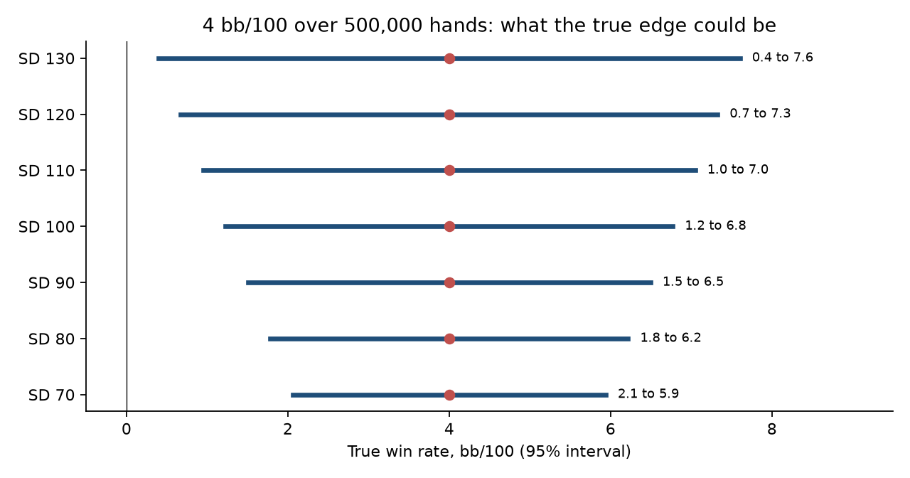
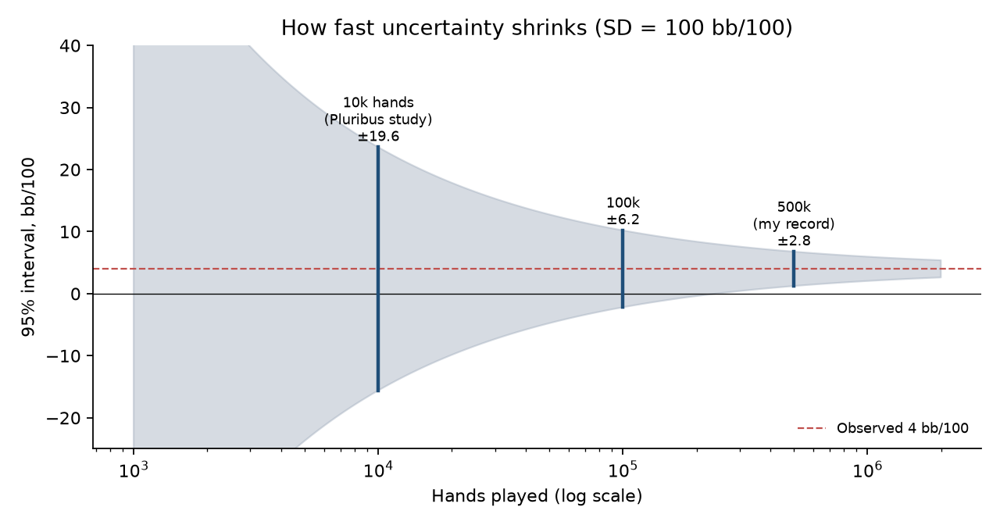
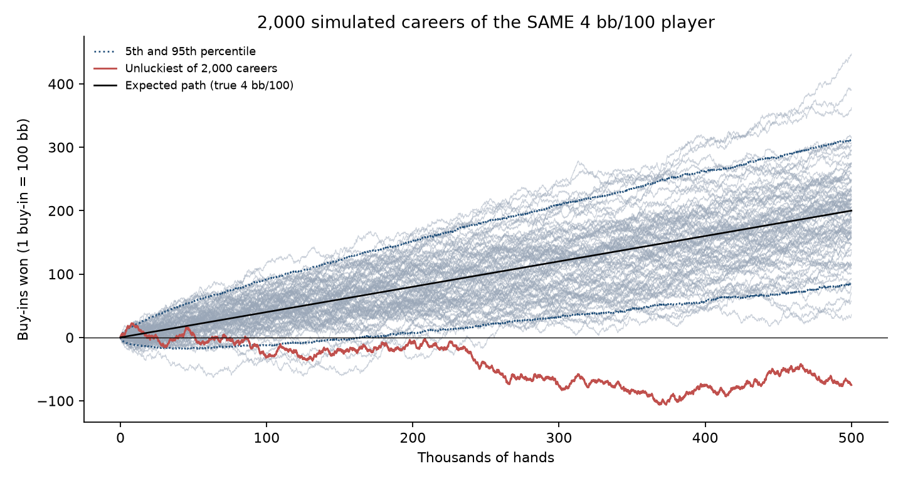
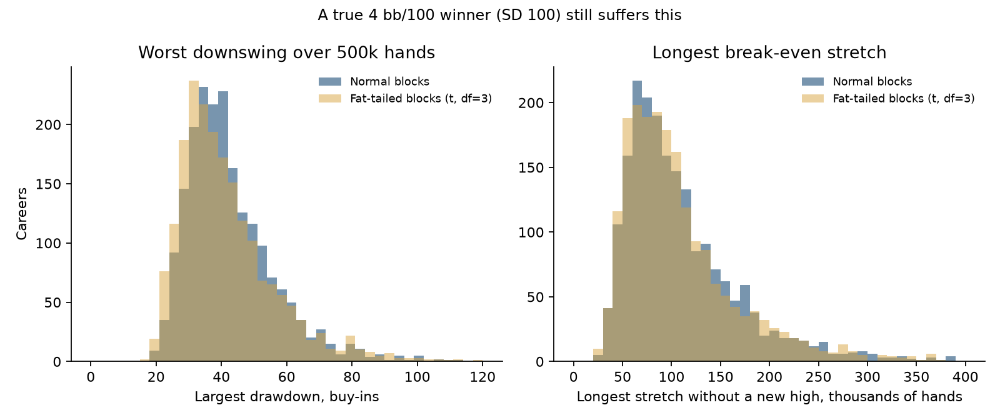
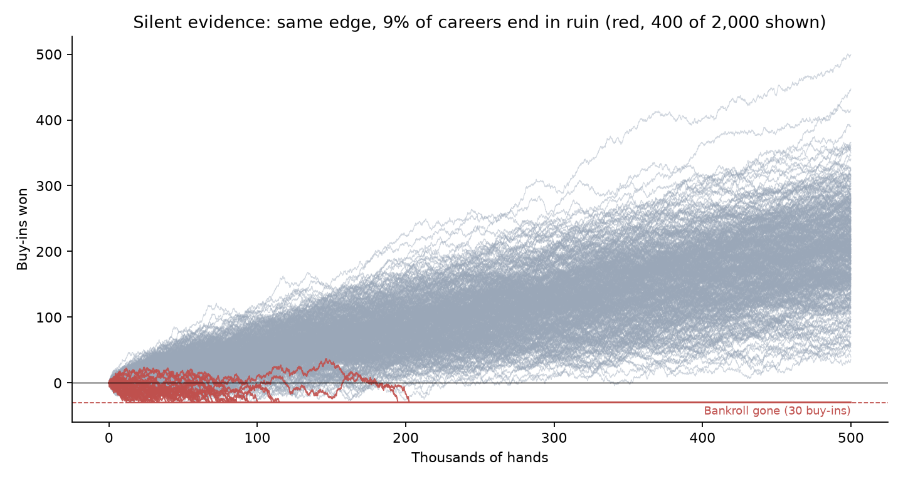
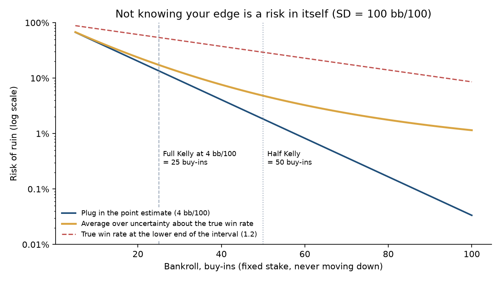
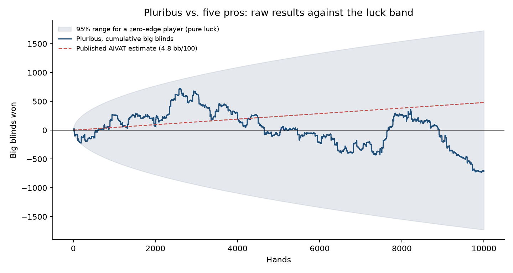
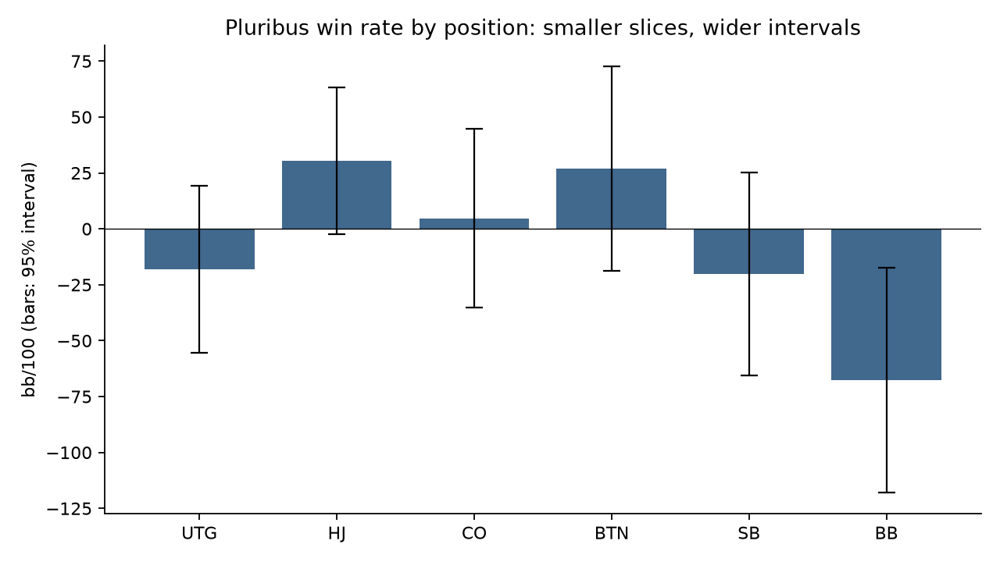

# Signal or Luck? What a Poker Win Rate Can and Can't Prove

*A risk study of my poker career, using statistics, simulation and SQL, and read through Nassim Taleb's ideas about randomness and ruin.*

From 2022 to 2024 I played online poker professionally: 500,000+ hands at roughly 4 big blinds per 100 hands (bb/100). This project asks the questions a risk manager or trader would ask about that record: **how much of it is skill, how much is luck, and how much capital does an edge that size need to survive?**

The same questions apply to any trading strategy. Win rate is expected return, standard deviation is volatility, downswings are drawdowns, and bankroll rules are position sizing.

Each part also applies one idea from Taleb's *Incerto*, the books that shaped how I thought about risk at the table. Every one of those ideas is turned into a number or a chart below.

**A note on data.** My original tracking database was lost with an old computer, so this project uses no hand-level data from my own play. Instead, it uses:

- **math and simulation** built on my self-reported totals, with the unknown standard deviation (SD) shown as a range rather than a single guess, and
- **real public data:** the 10,000 hands the poker AI Pluribus played against elite professionals (Brown & Sandholm, *Science*, 2019), which I load into a SQL database and analyze.

## Results at a glance

Base case: SD = 100 bb/100. Full numbers are in `results/simulation_summary.md`.

1. **500,000 hands prove the edge exists, but not its size.** An observed 4 bb/100 gives a 95% interval of about **1.2 to 6.8 bb/100**. Across SDs from 70 to 130, the lower end ranges from 2.1 down to 0.4. In every case, the probability that the true edge is positive stays above 98%.
2. **Over short windows, results are mostly noise.** A true 4 bb/100 winner is ahead after 100 hands only **51.6%** of the time, and after 10,000 hands only 65.5% of the time.
3. **A real winner still suffers long, deep downswings.** In 2,000 simulated careers of the *same* player, the typical worst drawdown was **about 40 buy-ins**. The typical longest stretch without a new high lasted **about 96,000 hands**.
4. **Survival comes before returns.** With a 30 buy-in bankroll and no moving down in stakes, **177 of those 2,000 careers went broke**. The group's average still looks excellent (+185 buy-ins), but that average belongs to no one who went broke.
5. **Not knowing your edge is a risk in itself.** Risk of ruin is convex in the win rate, so averaging it over the uncertainty from point 1 raises it. At 50 buy-ins it goes from 1.8% to **4.8%**. At 100 buy-ins it goes from 0.03% to **1.1%**, about 34 times higher. Fat tails inside the game mattered far less.
6. **In raw chips, the best player at the table lost.** Over the 10,000 public hands, the superhuman AI Pluribus finished at **−7.1 bb/100**. Its 95% interval runs from −24.4 to +10.2, which contains both a big loss and the published, luck-adjusted estimate of +4.8. Raw results would need about **124,000 hands**, 12 times the study, to be as precise as the authors' variance-reduced estimate.

**Reading my own record.** My results went from losing to break-even to winning. It is tempting to tell a clean story about the moment I got better, which Taleb calls the *narrative fallacy*. But the simulation shows that a player with a constant edge can look flat for around 100,000 hands, so the results curve alone cannot prove *when* I improved. The changes I made to my process (strict bankroll rules, moving from game-theory-optimal to exploitative play) are better evidence than the curve.

---

## Part 1: How precisely do 500,000 hands measure an edge?

Results in each block of 100 hands vary with standard deviation SD. Averaged over *n* blocks, the uncertainty shrinks with √n, so the standard error is:

```
SE = SD / sqrt(hands / 100)        95% interval = observed win rate ± 1.96 × SE
```

This relies on the Central Limit Theorem. A single poker hand is wildly skewed (you usually lose a little and occasionally win a lot), but averages over thousands of hands are close to normally distributed.



Uncertainty shrinks with the *square root* of the sample size, so doubling precision takes four times as many hands. That is why 10,000 hands (the size of the Pluribus study) tell you almost nothing on their own.



### Noise and signal

> **Taleb's lens.** In *Fooled by Randomness*, Taleb describes a dentist who owns a good portfolio but checks it constantly. Over short intervals almost everything he sees is noise, so he spends his days reacting to meaningless losses. The edge only becomes visible over long horizons.

A poker edge behaves the same way. The table shows the chance that a player with a true 4 bb/100 edge is ahead after each window:

| Window | Chance of being ahead |
|---|---|
| 100 hands (one short session) | 51.6% |
| 1,000 hands | 55.0% |
| 10,000 hands | 65.5% |
| 100,000 hands | 89.7% |
| 500,000 hands | 99.8% |

Judging a strategy session by session, or a trader day by day, means reacting mostly to noise.

### What variance looks like from the inside

> **Taleb's lens.** Taleb argues that a result should be judged against all the histories that *could* have happened, not only the one that did. A Monte Carlo simulation makes those alternative histories visible.

`src/simulate.py` simulates 2,000 careers of the *same* player, with a true 4 bb/100 edge and SD 100, over 500,000 hands. It measures what a trading desk measures for a strategy: maximum drawdown and time under water. Every grey line below is the same skill level. The red line is one of those histories, and a player who lived it would conclude they had no edge. They would be wrong.





I also re-ran the simulation with fat-tailed results: a Student-t distribution with the same volatility. It barely changed the drawdowns. That is less surprising than it sounds. In one hand you cannot lose more than the chips in front of you, so in-game losses have a hard cap, and averaging over 100 hands thins the tails further. In Taleb's terms, the game itself sits closer to *Mediocristan*, where no single observation dominates the total. His warnings about fat tails bite hardest in domains without such caps, like leveraged markets. In poker, the truly fat-tailed risks sit outside the game (see Limitations).

## Part 2: Survival first. How much bankroll does the edge need?

Treat winnings as a random walk with drift (the win rate) and volatility (the SD). The probability of *ever* losing a bankroll of B big blinds, while playing the same stake forever, is:

```
Risk of ruin = exp(-2 × win rate × B / SD²)
```

### Ensemble vs. time

> **Taleb's lens.** In *Skin in the Game*, building on physicist Ole Peters' work on ergodicity, Taleb contrasts two situations. In one, 100 different people each go to a casino once. In the other, one person goes 100 days in a row. In the first case, one gambler going broke does not affect the others, so the group average is meaningful. In the second, going broke on day 28 means there is no day 29. When ruin is possible, the average across many people says little about what happens to one person over time.

The simulation shows this directly. These are the same 2,000 careers as in Part 1, but now losing a 30 buy-in bankroll ends the career for good:

| Measure | Value |
|---|---|
| Average final result if ruin were impossible | +200 buy-ins |
| Average final result when ruin ends the career | +185 buy-ins |
| Careers that ended in ruin | 177 of 2,000 (8.8%) |



The group average barely moves, so an analysis of the group would call this strategy safe. For one player living one career, the number that matters is the 8.8% chance of not being around to collect. Taleb often warns against crossing a river just because it is four feet deep *on average*.

Taleb's idea of *silent evidence* explains why this is rarely seen in practice. Players who went broke stop posting graphs, so the visible record is built almost entirely from survivors. That includes my own record.

### Sizing: Kelly and via negativa

Choosing a stake to maximize long-run growth (the Kelly criterion) gives an optimal bankroll of SD² / win rate. At 4 bb/100 and SD 100, that is 2,500 bb, or 25 buy-ins. Plugged back into the formula, the risk of ruin at full Kelly is e⁻² ≈ **13.5%**, if you never move down in stakes. Half Kelly (50 buy-ins) gives e⁻⁴ ≈ 1.8%.

> **Taleb's lens.** Taleb uses the term *via negativa* (in *Antifragile*) for improving by removing what can harm you, rather than by adding. Good bankroll rules work this way. They are mostly rules about what *not* to do: don't play stakes your bankroll can't absorb, and move down after losses instead of chasing them. The math agrees. A Kelly bettor survives precisely because bet size shrinks as wealth shrinks.

### Not knowing your edge is a risk in itself

The formula needs the *true* win rate, but Part 1 showed it is only known as an interval. The naive approach plugs in the point estimate. A better approach averages the risk of ruin over everything the true win rate could plausibly be. Here, I treat the true win rate as normally distributed around 4, with the standard error from Part 1.

Risk of ruin is a *convex* function of the win rate: it rises faster when the win rate falls than it drops when the win rate rises. By Jensen's inequality, the averaged answer is therefore always higher than the naive one. This is a recurring theme in Taleb's technical writing: uncertainty about a model's parameters is itself a source of risk, and it does the most damage exactly where you feel safest.

| Bankroll (buy-ins) | Plug in 4 bb/100 | Average over uncertainty | If the true rate is 1.2 |
|---|---|---|---|
| 20 | 20.2% | 23.6% | 61.2% |
| 30 | 9.1% | 12.9% | 47.9% |
| 50 | 1.8% | 4.8% | 29.3% |
| 100 | 0.03% | 1.1% | 8.6% |

At 100 buy-ins, the naive estimate says ruin is essentially impossible. Accounting for uncertainty makes the risk about 34 times larger.



## Part 3: Real data with SQL, Pluribus vs. five professionals

In 2019, the AI Pluribus played 10,000 hands of six-player no-limit hold'em against professionals. The authors reported a win of 48 milli-big-blinds per hand (4.8 bb/100), with a standard error of 25 (2.5 bb/100). They did *not* use raw results to get that number. They used **AIVAT**, a variance-reduction technique that removes much of the luck of the cards. This is the noise-and-signal problem from Part 1 at research scale: even a superhuman player's raw results over 10,000 hands are dominated by luck.

**Pipeline**

1. `src/phh_loader.py` parses the hands, stored in the TOML-based Poker Hand History (PHH) format, into a SQLite database with three tables: `hands`, `hand_players` and `actions` (see `sql/schema.sql`).
2. `sql/queries.sql` holds the analysis in plain SQL:
   - a zero-sum reconciliation check (every hand's chips must net to zero),
   - win rate per player and by position,
   - VPIP and PFR: how often a player voluntarily puts money in before the flop, and how often they raise.
3. `src/analyze_pluribus.py` runs those queries, turns the results into confidence intervals, and compares the raw interval with the published AIVAT one. It saves figures plus `results/pluribus_summary.md`.

**A detail worth knowing:** in PHH, `cc` means "check *or* call." A big blind who checks when no one raised has not voluntarily put money in, so the VPIP query only counts a big blind's `cc` if a raise came earlier in the hand. The tests cover this case.

### Results: the raw record says Pluribus lost

All 10,000 hands loaded with a recorded result, and every one passes the zero-sum check. Full output is in `results/pluribus_summary.md`.

| Estimate | Win rate (bb/100) | Std. error | 95% interval |
|---|---|---|---|
| Raw results, 10,000 hands | **−7.1** | 8.8 | −24.4 to +10.2 |
| Published (AIVAT) | +4.8 | 2.5 | −0.1 to +9.7 |

The AI that the authors showed was better than elite professionals finished the public sample **709 big blinds down**. That does not contradict the paper. The raw standard deviation is 88 bb/100, close to the base case of 100 used in Parts 1 and 2, so over 10,000 hands a zero-edge player lands anywhere within about ±17 bb/100 by luck alone. Pluribus's curve never leaves that band:



This is the "dentist" from Part 1 at research scale. Judged by its raw results, the strongest player in the room looks like a losing one, and the noise is roughly 3.5 times wider than with AIVAT. To match AIVAT's precision with raw results alone would take about 124,000 hands. That is why the authors removed the luck instead of waiting for it to average out.

**Slicing makes it worse.** Split by position, each slice holds about 1,650 hands and the intervals widen to roughly ±40 bb/100:



| Position | Hands | bb/100 | 95% interval |
|---|---|---|---|
| UTG | 1,663 | −18.1 | −55.4 to +19.2 |
| HJ | 1,672 | +30.4 | −2.5 to +63.2 |
| CO | 1,682 | +4.8 | −35.3 to +44.8 |
| BTN | 1,692 | +26.8 | −18.9 to +72.5 |
| SB | 1,638 | −20.2 | −65.6 to +25.3 |
| BB | 1,653 | −67.7 | −117.9 to −17.4 |

Only the big blind's result is clearly different from zero. That is expected, because every player loses money from the blinds. Ranking positions, or players, on samples this size mostly ranks luck. The same applies to the 13 human labels in the data: all of their intervals include zero.

**Style is measurable long before results are.** Pluribus's preflop frequencies are almost identical to the pooled humans: VPIP 26.4% vs. 26.3%, and PFR 17.7% vs. 17.5%. Its edge is invisible in how often it plays, and it was buried in raw results over 10,000 hands. Unlike results, frequencies like these settle quickly, which makes process measures the more useful feedback over short samples. That is the same lesson as "Reading my own record" above.

## Limitations

### What the model can't see

> **Taleb's lens.** Taleb's *ludic fallacy* is the mistake of treating the clean, rule-bound randomness of games as if it were the randomness of real life.

This whole project models in-game variance, the kind that fits in a formula. For online professionals, some of the most serious risks were outside the game.

On April 15, 2011, a date players call Black Friday, the US Department of Justice indicted PokerStars, Full Tilt Poker and Absolute Poker. All three sites stopped serving US players. PokerStars customers were repaid within weeks; Full Tilt and Absolute customers waited years. No win-rate model contained that risk. Site closures, frozen balances, regulatory change and health are the real fat tails of a poker career. The same is true in trading, where counterparty, liquidity and regulatory risk rarely show up in a backtest.

### Technical limitations

- The simulations treat each 100-hand block as independent with a constant edge. Real win rates drift with stakes, opponents and game conditions, just as trading edges decay.
- The SD of my play is unknown, so it is shown as a range (70 to 130 bb/100) rather than a single value.
- The risk-of-ruin formula assumes continuous play at one fixed stake. The Monte Carlo version checks for ruin every 100 hands, so it slightly understates the risk.
- The "average over uncertainty" calculation treats the true win rate as normal around the observed one, which is a simple flat-prior approximation.
- In the Pluribus data, human player labels are anonymized seat names, so one label is not necessarily one person. I do not re-implement AIVAT, because it requires the bot's own strategy.

## How to run

Requires Python 3.11+.

```bash
pip install -r requirements.txt

# Parts 1 and 2: simulation (no data needed)
python -m src.make_figures

# Part 3: get only the Pluribus folder of the public PHH dataset (MIT license)
git clone --depth 1 --filter=blob:none --sparse https://github.com/uoftcprg/phh-dataset.git
cd phh-dataset
git ls-tree -d --name-only HEAD data/      # find the Pluribus folder name
git sparse-checkout set data/<pluribus-folder>
cd ..

python -m src.phh_loader phh-dataset/data/<pluribus-folder> --db data/poker.db
python -m src.analyze_pluribus --db data/poker.db

# Tests (they use small hand-made fixtures, not real hands)
python -m tests.test_project
```

The loader reports how many hands lack recorded final stacks. Add `--replay-missing` (requires `pip install pokerkit`) to try replaying them.

## Repository layout

```
src/winrate.py           confidence intervals, sample-size math, noise vs. signal
src/simulate.py          Monte Carlo careers, drawdowns, time under water
src/bankroll.py          risk of ruin, convexity adjustment, absorbing barrier, Kelly
src/make_figures.py      figures and numbers for Parts 1 and 2
src/phh_loader.py        PHH hand histories -> SQLite
src/analyze_pluribus.py  SQL analysis, intervals, figures for Part 3
sql/schema.sql           database tables
sql/queries.sql          named analysis queries
tests/                   unit tests with synthetic fixtures
```

## Next step

The full PHH dataset on Zenodo also contains about 21.6 million anonymized online hands from 2009, from sites including the three named above. With it, I could test **skill persistence**: does a player's win rate in the first half of their hands predict their win rate in the second half? This is the same question asset managers ask about fund performance, and the survivorship issue from Part 2 applies to it directly. First, I would need to check that player IDs stay consistent across hands.

## References

- Brown, N. & Sandholm, T. (2019). Superhuman AI for multiplayer poker. *Science*, 365(6456), 885–890.
- Burch, N., Schmid, M., Moravčík, M., Morrill, D. & Bowling, M. (2018). AIVAT: A new variance reduction technique for agent evaluation in imperfect information games. *AAAI*.
- Kelly, J. L. (1956). A new interpretation of information rate. *Bell System Technical Journal*.
- Kim, J. Poker Hand History (PHH) format and dataset, University of Toronto Computer Poker Research Group. github.com/uoftcprg/phh-dataset
- Peters, O. (2019). The ergodicity problem in economics. *Nature Physics*, 15, 1216–1221.
- Taleb, N. N. (2001). *Fooled by Randomness*.
- Taleb, N. N. (2007). *The Black Swan*.
- Taleb, N. N. (2012). *Antifragile*.
- Taleb, N. N. (2018). *Skin in the Game*.
- Taleb, N. N. (2020). *Statistical Consequences of Fat Tails*.
